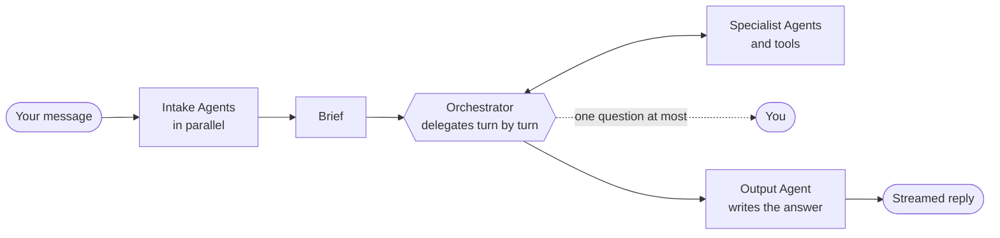
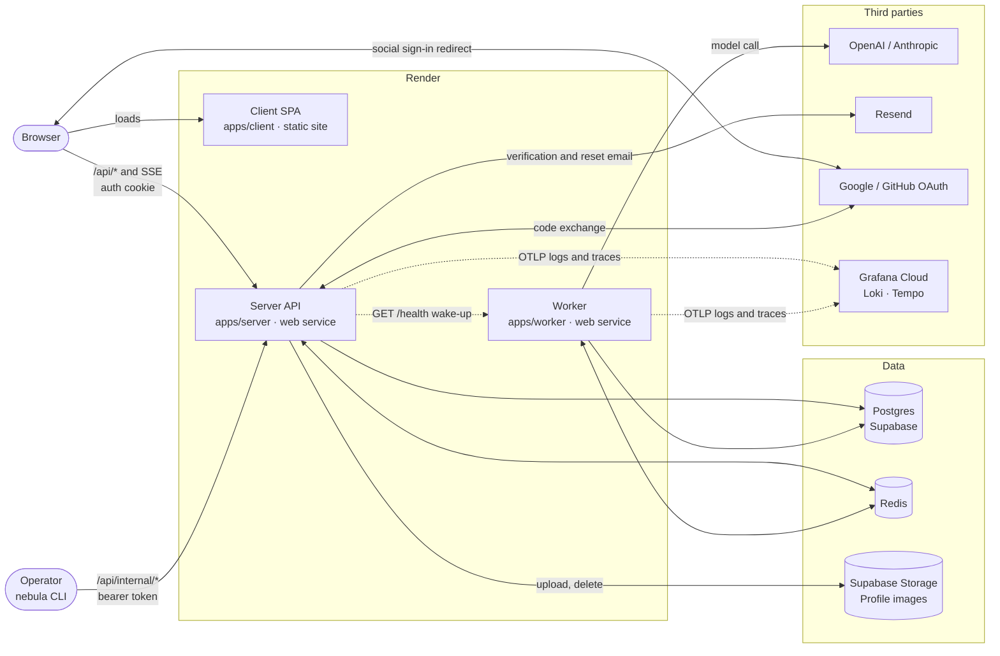

# Nebula Chat

**A multi-agent orchestration platform for AI work, built on a chat product you can try in seconds.**

One question in, one considered answer out. Behind it, a team of specialised AI Agents is meant to
understand the request, split it up, research, critique and write the reply, while you watch each step
and stay in control of the spend. The chat foundation is live today. The orchestration layer is designed
and being built on top of it.

🌐 **App:** <https://www.nebula-chat.cz> · **API:** <https://api.nebula-chat.cz>

## The idea

A **Run** answers one message by orchestrating Agents instead of making a single model call:



- **Specialised roles.** Each Agent is a fixed pairing of model, prompt and tools, defined by the
  application rather than invented on the fly.
- **Inspectable.** Every Step is recorded, so a Run can be read back, resumed and audited.
- **Bounded.** A Run budget caps the tokens it may spend and ends the Run early with a partial answer
  instead of failing.
- **Opt-in.** Pick it per message, or keep the plain direct reply for quick questions.

The domain terms are defined in [CONTEXT.md](./CONTEXT.md).

## What works today

- **Zero-friction start.** Guests chat immediately; signing up *claims* their existing conversations
  instead of resetting them.
- **Pick the model per conversation.** Switch between OpenAI and Anthropic models without losing the thread.
- **Live, resumable streaming.** Replies keep generating if you drop offline and pick up where they left
  off; a Stop button cancels one mid-flight.
- **Accounts done properly.** Email verification, password reset, social sign-in, profile images,
  sign-out everywhere, and self-serve account deletion with a 30-day grace period.
- **Run like a service.** Token budgets enforced per request, structured logs and traces in Grafana, and an
  operator CLI to change log levels in production without a deploy.
- **A worker built for it.** Every model call already runs off a job queue in its own service, which is
  where Runs will execute.

## How it fits together



The browser only ever talks to the **server**, which owns auth and history and relays replies over SSE.
The **worker** owns every model call and takes its jobs off Redis, so slow LLM work never blocks the API
and each side scales on its own. It is also where orchestrated Runs will execute. [Architecture deep dive →](./docs/architecture.md)

## Built with

TypeScript end to end: React and Chakra UI on the client, Fastify and Drizzle on PostgreSQL on the server,
BullMQ and Redis Streams for the reply pipeline, LangChain for providers, Better Auth for identity,
OpenTelemetry into Grafana Cloud. A pnpm + Turborepo monorepo with a typed OpenAPI contract between the
apps, unit tests behind an 80% coverage gate, and automated releases.

## Run it locally

You need Node `26.12.1`, pnpm, Podman and an OpenAI or Anthropic API key.

```bash
pnpm install
podman compose up -d
pnpm --filter @nebula-chat/db db:migrate
```

Then start the server, worker and client. [Full setup guide →](./docs/getting-started.md)

## Learn more

| | |
| --- | --- |
| [Architecture](./docs/architecture.md) | Deployment, packages, data model and the flows that cross apps |
| [Authentication](./docs/auth.md) | Sign-in, guests, the message allowance and claiming |
| [Observability](./docs/logging.md) | Logging, tracing and runtime log levels |
| [Domain glossary](./CONTEXT.md) | The language the product and code share |
| [Contributing](./AGENTS.md) | Conventions, git workflow and testing |
