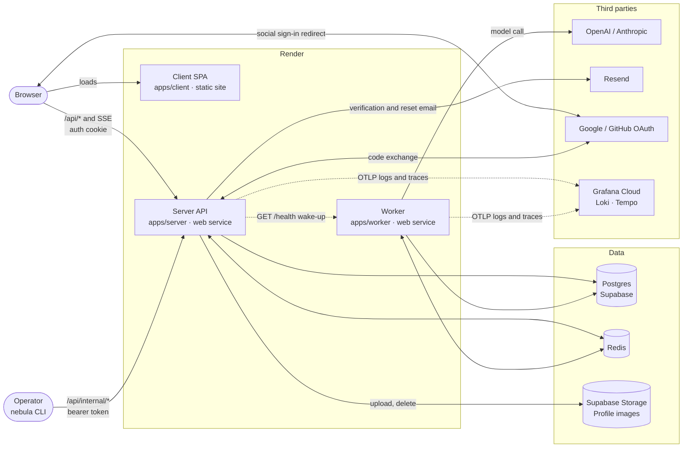
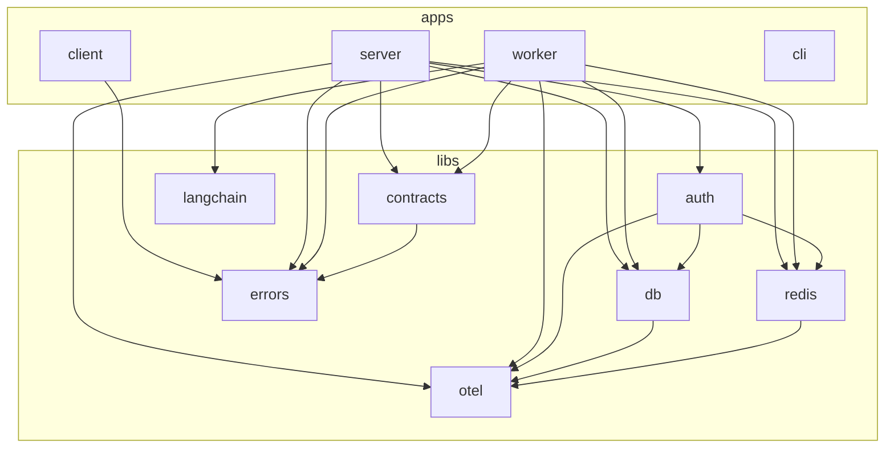
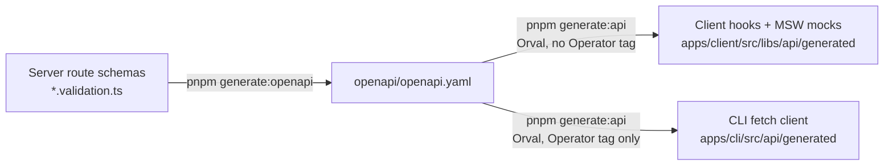
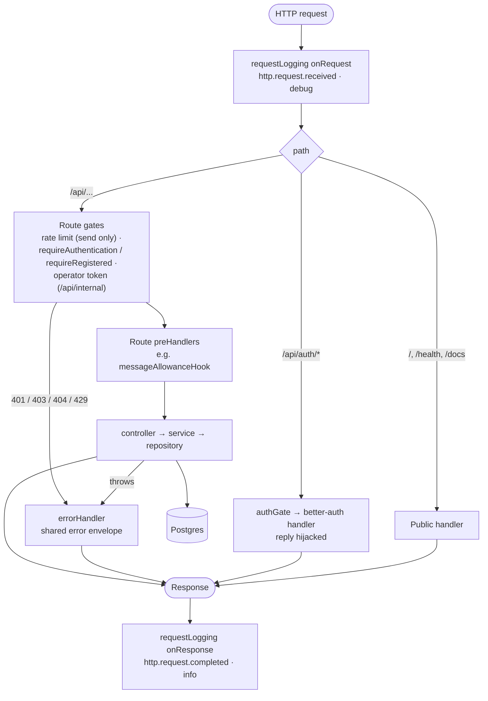
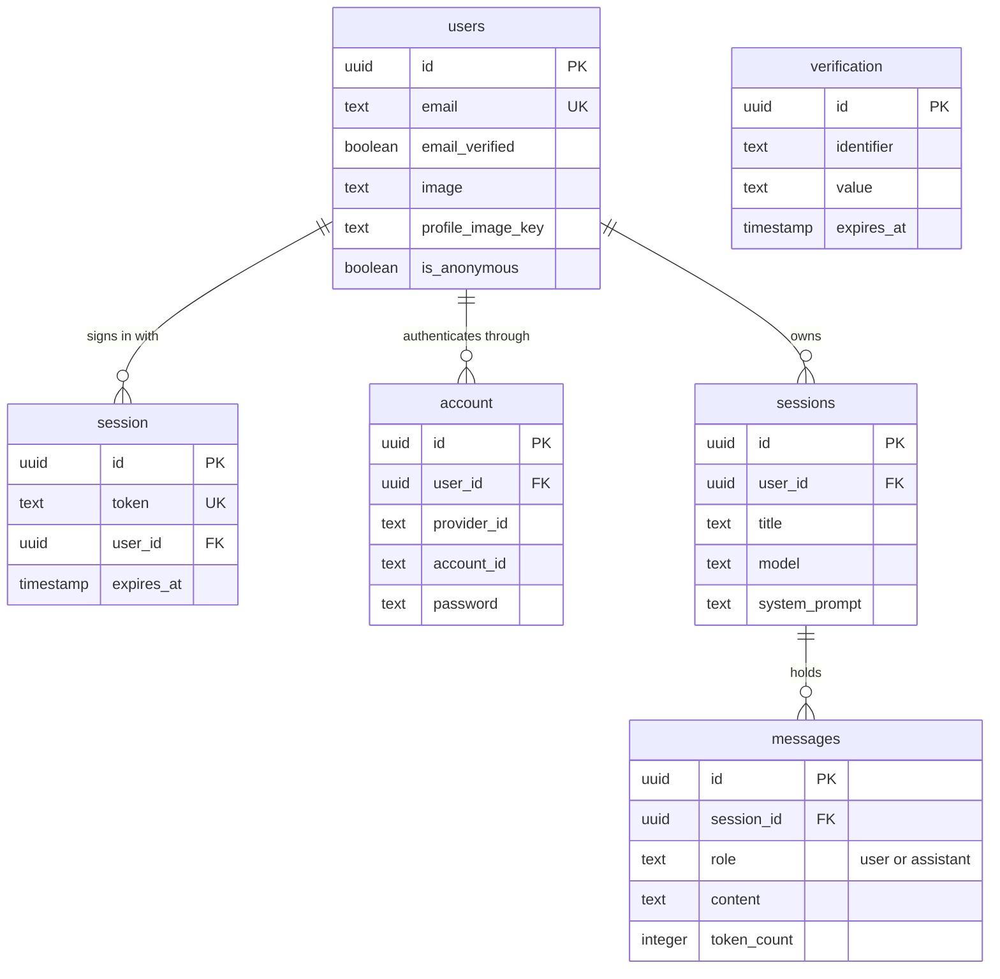
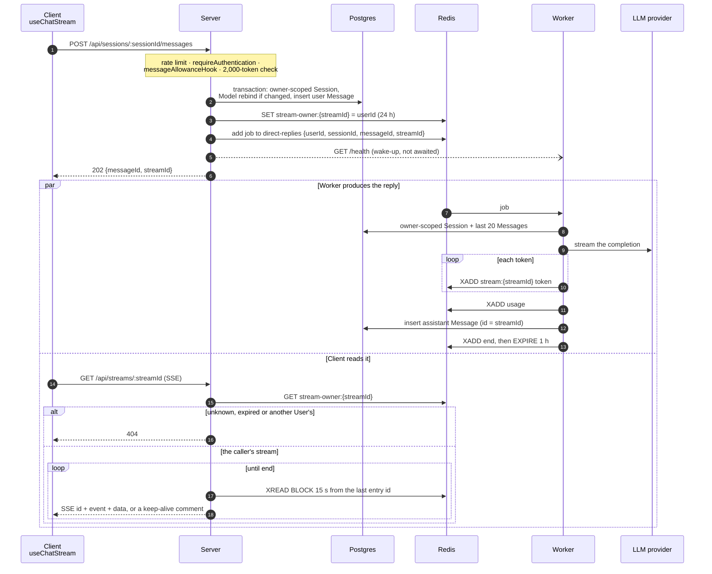
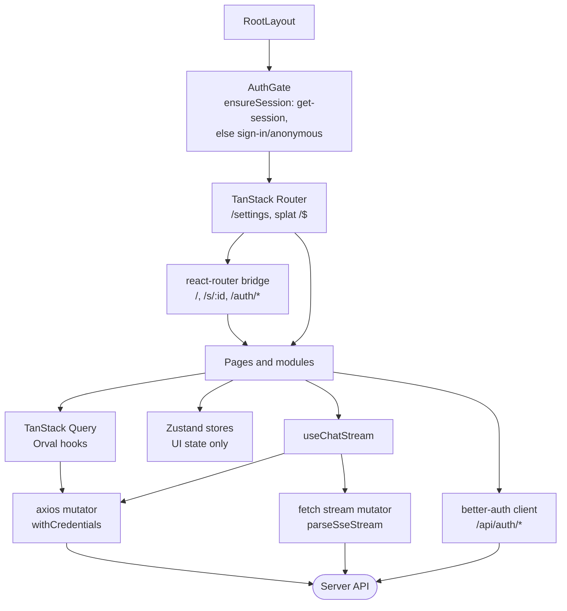
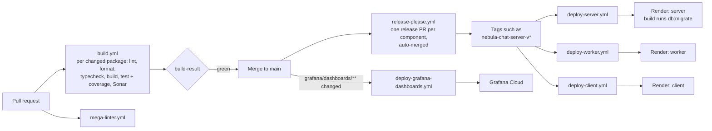

# Architecture

How Nebula Chat fits together today: the running pieces, the packages they are built from, the data
they keep, and the flows that cross more than one app. Each diagram draws what the code does now;
a design that is only proposed lives in its ADR. Feature-level flows sit next to their prose:
sign-in, the Claim and the Message allowance in [auth.md](./auth.md), log export and runtime log
levels in [logging.md](./logging.md). Domain terms (Session, Message, Direct reply, Run) are
defined in [CONTEXT.md](../CONTEXT.md).

## System context

- **The server** is the only thing a browser or the CLI talks to: auth, reads, persisting user
  input, and relaying replies over SSE. It holds no LLM keys.
- **The worker** owns every model call ([ADR-0013](./adr/0013-worker-app-owns-all-llm-execution.md)).
  It takes jobs off Redis, not HTTP. Its `/health` route exists because Render's free plan runs
  it as a web service that sleeps, and the server's ping on every enqueue wakes it.
- **Redis** carries auth state, the job queue, per-reply streams and log-level pub/sub; see
  [Redis keyspace](#redis-keyspace).
- **Telemetry** goes straight from each process to Grafana Cloud over OTLP, with no collector
  ([logging.md](./logging.md#exporting-logs)).

## Workspace packages

Arrows point from a package to the workspace packages it depends on.

- `server` and `worker` never import each other. What they share is a lib: `contracts` for the
  job payload and reply stream events, `otel` for logging and process wiring, `db` and `redis` for
  the clients.
- `langchain` is a dependency of the worker only, until it is dissolved into it.
- `cli` depends on no workspace package: it is a client of the public HTTP API
  ([ADR-0029](./adr/0029-operator-cli-as-an-api-client.md)). So is `client`, apart from the
  isomorphic error codes in `errors`.

## API contract

The server's Zod route schemas are the single source of the HTTP contract
([ADR-0018](./adr/0018-fastify-zod-openapi-named-schemas-env-free-spec.md)).

better-auth's `/api/auth/*` routes are not in this spec; they have their own reference at
`/api/auth/reference` ([auth.md](./auth.md#interactive-reference)).

## A request through the server

Every route is registered in `apps/server/src/app.ts`. There is no global auth hook: each route
names its gates, so a route without one is public.

- **Gates** read the auth session from the cookie cache, else Redis, and bind `user.id` to
  `req.log`. `requireRegistered` turns a Guest away with `403`.
- **Errors** are thrown as `AppError`s and shaped once by the error handler
  ([ADR-0011](./adr/0011-shared-errors-lib-and-typed-envelope.md)); only `5xx` is logged there.
- **Rate limits**: the send route allows 10 a minute per IP, in memory. better-auth limits its own
  routes with counters in Redis, and Profile image uploads are capped at 10 an hour per User.

## Data model

Postgres, through Drizzle (`libs/db/src/schema.ts`). `users`, `session`, `account` and
`verification` are better-auth's tables; `sessions` and `messages` are the chat domain. Two
similar names on purpose: `session` is a sign-in (an _auth session_), `sessions` is a chat
Session.

- Every foreign key cascades on delete, so deleting a User removes their Sessions and Messages.
- better-auth keeps live sign-ins and verification tokens in Redis (`secondaryStorage`), so the
  `session` and `verification` tables stay empty in practice.
- An assistant Message's `id` is its reply stream's `streamId`, so one id names both.

## Redis keyspace

| Key or channel                                                 | Written by  | Read by        | Lifetime                    | Purpose                                                                          |
| -------------------------------------------------------------- | ----------- | -------------- | --------------------------- | -------------------------------------------------------------------------------- |
| `auth:*`                                                       | better-auth | better-auth    | set by better-auth          | Sign-in sessions, verification tokens, auth rate-limit counters                  |
| `auth:profile-image-uploads:<userId>`                          | server      | server         | 1 hour window               | Profile image upload limit                                                       |
| BullMQ queue `direct-replies`                                  | server      | worker         | last 1000 kept              | Direct reply jobs, IDs only (`@nebula-chat/contracts`)                           |
| `stream:<streamId>` (Redis Stream)                             | worker      | server         | 1 hour after the reply ends | One reply's `token` / `usage` / `error` / `end` events                           |
| `stream-owner:<streamId>`                                      | server      | server         | 24 hours                    | Who may read a reply stream; the assistant Message does not exist yet            |
| `log-level:<service>` (pub/sub)                                | server      | every instance | message                     | Runtime log level change ([logging.md](./logging.md#changing-levels-at-runtime)) |
| `log-level-report:<service>`, `log-level-reply:<service>:<id>` | server      | every instance | message                     | Reading every instance's levels back                                             |

`<service>` is `nebula-chat-server` or `nebula-chat-worker`.

## Direct reply

One Direct reply, from send to the last token. Sending and reading are separate requests
([ADR-0014](./adr/0014-redis-streams-delivery-and-split-send-stream-api.md)): the send returns
before any model work, and the reply is read from a Redis Stream the worker writes.

- **Order.** The worker appends events one after another, so tokens arrive in the order the
  model produced them, and `end` is always last.
- **Failure.** Any failure in the worker becomes an `error` event carrying the shared error
  envelope, then `end`. Tokens already produced are written first.
- **A sleeping worker** only delays the reply: the job waits in the queue, and the relay keeps
  the SSE response open with keep-alive comments.
- **Not yet built.** Resuming with `Last-Event-ID`, cancelling a reply, and the response cache;
  each is a later ticket under ADR-0013 and ADR-0014.

## The client

- **Server state** is TanStack Query only, through hooks Orval generates
  ([ADR-0012](./adr/0012-adopt-tanstack-query-for-server-state.md)); Zustand holds UI state.
- **The reply stream** is the one request that bypasses axios: it needs the raw `Response` body.
- **Routing** is mid-migration to TanStack Router
  ([ADR-0025](./adr/0025-tanstack-router-replaces-react-router.md)); a splat route hands what is
  not yet migrated to react-router.

## Build, release and deploy

- Render's own auto-deploy is off; a deploy workflow POSTs the service's deploy hook when a
  release tag for the app, or for a lib it is built from, is pushed.
  `validate-deploy-triggers.yml` fails CI when a deploy workflow misses one.
- Migrations run in the server's build, so the schema moves before the new server starts. The
  worker reads the same schema and deploys on a `db` release too.

## Known gaps

What the diagrams above show but the system does not yet do well:

- **Runtime log levels reach the server only.** The worker listens on
  `log-level:nebula-chat-worker`, but `POST /api/internal/log-level` publishes to the server's
  channel alone, so the CLI cannot change or read the worker's levels yet.
