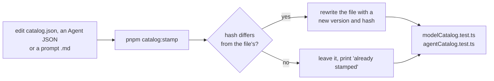

# Catalogs and stamping

Two checked-in JSON catalogs describe what the platform may run. Both are static data, parsed and validated
when their package loads, and both carry a `version` and a `hash` so a change that skips the stamp fails in CI.

| Catalog       | Data                                                                        | Loader                                      | Read by                           |
| ------------- | --------------------------------------------------------------------------- | ------------------------------------------- | --------------------------------- |
| Model catalog | `libs/contracts/src/models/catalog.json`: Models, prices, provider defaults | `libs/contracts/src/models/modelCatalog.ts` | server, worker, client (ADR-0030) |
| Agent catalog | `apps/worker/src/agents/<name>.json`: one file per Agent (seven in all)     | `apps/worker/src/runs/agentCatalog.ts`      | worker only (ADR-0013)            |

The Agent catalog is not exposed by the server or the client, and nothing records its hash on a Run or a Model
call: the hash only detects drift. Its Models must exist in the Model catalog, so an Agent naming an unknown
Model fails when the worker boots.

The current Models and Agents, with prices and parameters, are listed in [docs/catalog.md](./catalog.md). That page
is kept by hand: a PR that adds, changes or removes a Model or an Agent (its JSON or its prompt) updates it.

## What a stamp is

`version` is `YYYY-MM-DD-<uuid>`: the day it was stamped and a fresh id for that change. `hash` is a SHA-256 of
the content below, so formatting and key order never move it.

| File          | Hashed content                                                                                         |
| ------------- | ------------------------------------------------------------------------------------------------------ |
| Model catalog | `defaultModels` and `models`                                                                           |
| Agent file    | every field except `version` and `hash`, plus the text of its prompt (`resources/prompts/<prompt>.md`) |

A prompt edit therefore changes its Agent's hash, and a whitespace or line-ending change in a prompt does too.

## Changing a catalog

1. Edit the Model catalog, an Agent's JSON in `apps/worker/src/agents/` or a prompt in
   `apps/worker/src/resources/prompts/`.
2. Run `pnpm catalog:stamp` from the root. It rewrites only the stale files and is a no-op when everything is
   current, so it is safe to run after any change.
3. Update [docs/catalog.md](./catalog.md) to match, and commit it with the stamped files. Without the stamp, `libs/contracts/src/models/tests/modelCatalog.test.ts`
   or `apps/worker/src/runs/tests/agentCatalog.test.ts` fails.

`scripts/stamp-catalogs.ts` does the work. It imports only `apps/worker/src/runs/agentHash.ts`, which uses
nothing but `node:crypto`: the CI `scripts` job typechecks `scripts/` with only the root install, so the script
cannot load the worker loader or the workspace libs.

## Adding an Agent

The Agent set is fixed in the schema (`AGENT_NAMES` and `DELEGATE_NAMES` in `agentCatalog.ts`), which keeps
`AGENTS.output` and the other accessors literally typed, so a new Agent is a code change and not only a new file:

1. Add the name to the right list in `agentCatalog.ts`, and its JSON import to the `parseAgentCatalog` call.
2. Add `agents/<name>.json` (`kind` is `agent` or `delegate`; a delegate also needs a `description`) and its
   prompt in `resources/prompts/` with its name in `PROMPT_NAMES` (`llm/prompts.ts`).
3. Add the name to the file lists in `scripts/stamp-catalogs.ts` and `agentCatalog.test.ts`, then stamp.

The loader rejects: an unknown Model, tool or prompt, a `name` that does not match its file, a missing or extra
Agent, a delegate without a `description` (or an Agent with one), a `temperature` outside 0 to 2 and a `maxTokens`
that is not a positive integer.
