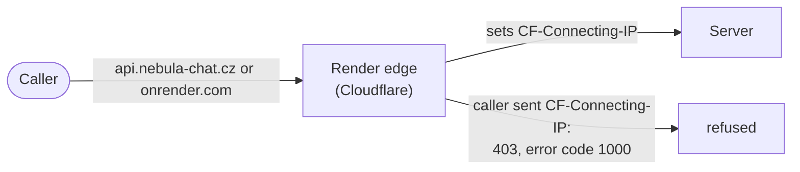

# Origin access

Every per-IP rate limit, Fastify's and better-auth's, keys on `CF-Connecting-IP`
([rate-limits.md](./rate-limits.md#client-key)). That is safe only if a caller can't choose the header's value.
This page records why they can't, and how to check that it still holds.

## Why the header can't be forged

The domain's DNS is at WEDOS, and `api.nebula-chat.cz` points at Render with no Cloudflare account of our own in
front. Render's edge runs on Cloudflare, though, and every request to the server passes through it, whether it uses
the custom domain or the `onrender.com` URL. That edge sets `CF-Connecting-IP` itself. A request that arrives already
carrying the header is refused at the edge with `403` and `error code: 1000`, so it never reaches the server.



No server-side check is needed for this. A shared secret header or Authenticated Origin Pulls would both need a
Cloudflare zone of our own, and Render's inbound IP allowlist needs the Scale plan.

## Checking it still holds

Run this after a move to another host or edge, or if Render changes its edge. Use any route; without an operator
token this one answers `404` from the server:

```bash
curl -si https://api.nebula-chat.cz/api/internal/log-level | head -1
curl -si -H 'CF-Connecting-IP: 203.0.113.1' https://api.nebula-chat.cz/api/internal/log-level
```

The first request should return the server's `404`, a JSON body with its security headers. The second should be the
edge's `403` with the plain-text body `error code: 1000`. Repeat both against the service's `onrender.com` URL.

If the second request ever reaches the server, so that it also returns a `404`, the header is forgeable again. The
per-IP limits then no longer hold, and the origin has to be locked to a trusted proxy.
