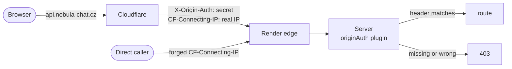

# Origin access

The server's Render origin answers only requests that came through Cloudflare. The client IP behind every
per-IP rate limit, Fastify's and better-auth's, is read from `CF-Connecting-IP`
([rate-limits.md](./rate-limits.md#client-key)). Cloudflare overwrites that header, but a request sent straight to
Render carries whatever value the caller chose, so each request would get a fresh bucket. It would also skip
Cloudflare's WAF and DDoS protection.

## How it works



- **Cloudflare** adds `X-Origin-Auth: <ORIGIN_AUTH_SECRET>` to every request for `api.nebula-chat.cz`, through a
  request header Transform Rule.
- **The server** (`plugins/originAuth.plugin.ts`) refuses any request without that exact value with `403 Forbidden`,
  before any other work. The compare is timing-safe. `/health` is exempt because Render's health check
  comes from inside Render and can't send the header. With `ORIGIN_AUTH_SECRET` unset the check is off, which is
  what local development and tests use. On Render an unset secret fails boot.
- **Render's `onrender.com` subdomain is off** (`renderSubdomainPolicy: disabled` in `render.yaml`), so the default
  URL answers 404. That alone is not enough, since a caller can still reach Render's edge with
  `Host: api.nebula-chat.cz`, which is why the header check exists.

The options that need no server code don't fit the free plan. Render's inbound IP allowlist (which could limit
traffic to Cloudflare's ranges) needs the Scale plan. Cloudflare Authenticated Origin Pulls needs mTLS verification
at the origin, and Render terminates TLS itself.

## Setting it up

Do this once per server service, and again for a new one. Steps 2 and 3 must happen in this order: an extra header
is harmless before the server checks it, but a server that checks before Cloudflare sends it refuses every request.

1. **Check the client.** In Render, `nebula-chat-client`'s `VITE_API_URL` must be `https://api.nebula-chat.cz`, not
   the `onrender.com` URL. Do the same for any `nebula` CLI profile.
2. **Cloudflare.** Generate a secret with `openssl rand -hex 32`. Then go to Rules → Transform Rules → _Modify Request
   Header_ → Create rule. Match _Hostname equals `api.nebula-chat.cz`_, then _Set static_ header `X-Origin-Auth` to the
   secret. Deploy it.
3. **Render.** On `nebula-chat-server`, set the environment variable `ORIGIN_AUTH_SECRET` to the same secret, then
   deploy a release that includes this change.
4. **Render subdomain.** Sync the Blueprint, which applies `renderSubdomainPolicy: disabled`, or turn off _Render
   Subdomain_ under Settings → Custom Domains. The service needs `api.nebula-chat.cz` as a custom domain first.

## Verifying

Replace `<service>` with the service's `onrender.com` name and `<render-ip>` with an address of Render's edge, which
`dig +short <service>.onrender.com` gives while the subdomain is still on.

```bash
# The default subdomain is off: 404.
curl -si https://<service>.onrender.com/ | head -1
# Render's edge reached directly, with a forged client IP: 403 from the server.
curl -si --resolve api.nebula-chat.cz:443:<render-ip> -H 'CF-Connecting-IP: 203.0.113.9' https://api.nebula-chat.cz/ | head -1
# Through Cloudflare: 200.
curl -si https://api.nebula-chat.cz/ | head -1
```

To confirm that Cloudflare overwrites a forged `CF-Connecting-IP`, send 11 requests through Cloudflare to the
`/api/internal/*` scope, which allows 10 per minute per IP, each with a different forged IP. The 11th still gets a
`429`, because every request was counted against your real IP:

```bash
for i in $(seq 1 11); do
  curl -s -o /dev/null -w '%{http_code}\n' -H "CF-Connecting-IP: 203.0.113.$i" https://api.nebula-chat.cz/api/internal/log-level
done
```

Each refused direct request also writes an `http.request.completed` line with `http.response.status_code` 403.

## Rotating the secret

Cloudflare sends one value, so a rotation has a short window of 403s. Update the Transform Rule and the Render
variable back to back, Cloudflare first, and redeploy the server.
